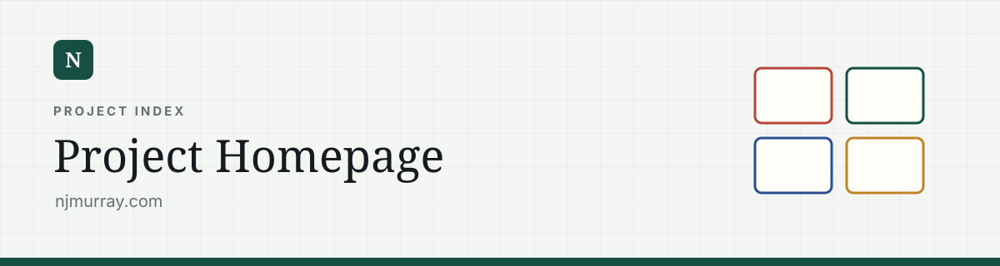

# Project Homepage

The front door to Nic Murray's mini apps at [njmurray.com](https://njmurray.com/). Each app has its own GitHub repository and Cloudflare deployment. Updating an app does not require rebuilding the homepage: its card points to the app's stable domain.

## Project map

The public [projects.json](projects.json) catalog records the canonical URL, repository, and Cloudflare project for each site. The build checks that every app card agrees with it.

| Site | GitHub repository | Cloudflare deployment |
| --- | --- | --- |
| [Homepage](https://njmurray.com/) | [homepage](https://github.com/NicJMurray/homepage) | Pages `homepage` |
| [Playlist Finder](https://playlist.njmurray.com/) | [spotify-playlist-finder-v2](https://github.com/NicJMurray/spotify-playlist-finder-v2) | Pages `spotify-playlist-finder-v2` |
| [Spotify Playlists](https://playlists.njmurray.com/) | [playlists](https://github.com/NicJMurray/playlists) | Pages `playlists-git` |
| [Fresh Tracks](https://fresh.njmurray.com/) | [fresh-tracks](https://github.com/NicJMurray/fresh-tracks) | Worker `fresh-tracks` |
| [Reading List](https://books.njmurray.com/) | [njmurray-books](https://github.com/NicJMurray/njmurray-books) | Worker `njmurray-books` |
| [Rare Word Explorer](https://rare-words.njmurray.com/) | [gutenberg-v2](https://github.com/NicJMurray/gutenberg-v2) | Worker `gutenberg` |
| [Photography](https://photography.njmurray.com/) | [photography](https://github.com/NicJMurray/photography) | Pages `photography` |
| [Scraper](https://scraper.njmurray.com/) | [london-jobs-watcher_v2](https://github.com/NicJMurray/london-jobs-watcher_v2) | Worker `london-jobs-watcher` |

`playlist.njmurray.com` is the Playlist Finder; `playlists.njmurray.com` is the album-art gallery. They are separate apps. [NDVIChina](https://github.com/NicJMurray/NDVIChina) is a research repository, not a hosted mini app.

## Local development

```powershell
npm.cmd ci
npm.cmd run build
npm.cmd run dev
```

`npm run build` validates the catalog, card links, and redirects, runs the pool physics tests, then copies an explicit allowlist of public files to `dist/`. Run `npm test` to check the physics on its own. Cloudflare Pages must publish `dist`, not the repository root. Development scripts, documentation, Git metadata, dependencies, and old photography assets are not in the published output.

See [DEVELOPMENT.md](DEVELOPMENT.md) for the Codex editing workflow and [DEPLOYMENT.md](DEPLOYMENT.md) for hosting settings and verification.

## How the homepage works

`index.html` contains the static navigation, project cards, inline styles, analytics, and footer year. Each card has a normal HTML title link stretched across the card, so app navigation does not depend on JavaScript. The responsive layout and all app descriptions are maintained here; the catalog validates URLs rather than rendering the page.

The seven card symbols are playable 48px pool balls. Pull back with a mouse or finger and release to shoot in the opposite direction; a small arrow grows and changes from green to red as power increases. Balls roll across the visible screen, bounce off its edges and each other, and disappear into the pocket at the top right. The pocket and loose balls stay in view while scrolling. A reset button beside the pocket restores all balls to their cards. Keyboard users can focus a ball, aim with Left/Right, change power with Up/Down, and shoot with Enter or Space. Escape cancels aiming and Home resets all balls.

A small inline Canvas 2D renderer wraps each original SVG onto ivory spots on a coloured, lightly textured ball. Its orientation follows distance travelled, with fixed lighting and a shared hemisphere geometry. Rendering is capped at 2x pixel density and 60 frames per second, uses one animation loop, and stops when the balls settle or the page is hidden. Reduced-motion preferences suppress the pocket animation; shots still respond to deliberate input. The fixed-step physics includes friction, equal-mass collisions, and swept pocket detection. There are no new libraries, external assets, or runtime requests; the page remains one HTML document. The Node tests exercise the actual inline physics code.

Pot every ball to trigger a short canvas confetti burst and a results dialog. The timer starts on the first actual ball movement, includes time between shots, and stops when the last ball enters the pocket. Reset and Play again clear the round timer and confetti without clearing the personal best. The fastest time is saved per browser profile in localStorage, keyed by the number of balls; no account or cross-device identity is implied. If storage is blocked the result still appears, with a clear unsaved message. Reduced motion skips confetti.

Sphere controls are native buttons, separate from the card links. Keep them as siblings of the links rather than nesting interactive controls inside an anchor. A sphere gesture must never navigate, while the rest of the card remains a normal link. Without JavaScript or canvas support, the original SVG remains visible and the whole card still opens its app.

Photography now belongs to its own repository and domain. The homepage loads its feature image from that domain. `_redirects` forwards old `/photography` and `/photography/*` links to the corresponding new location. The historical `photography/` directory and `photos:sync` script are retained in Git for reference and are excluded from deployment; edit the separate photography repository for future photo updates.

## File map

| File | Purpose |
| --- | --- |
| `index.html` | Homepage content, layout, navigation, and card links |
| `projects.json` | Public project, repository, and deployment catalog |
| `_headers` | Cloudflare response headers and cache directives |
| `_redirects` | Legacy photography redirects |
| `scripts/check-site.mjs` | Catalog, links, and redirect validation |
| `test/pool-physics.test.cjs` | Shot, collision, pocket, and rolling physics checks |
| `scripts/build-site.mjs` | Allowlisted production output in `dist/` |
| `scripts/publish-site.mjs` | Manual recovery deployment of the same built output |
| `AGENTS.md` | Instructions for future Codex work |
